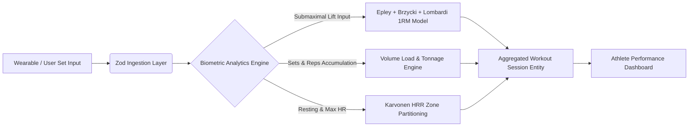

<div align="center">

# ⚡ Pulse Fitness Tracker

**Next-Generation Strength & Endurance Analytics Platform**

[](https://github.com/flegartech-mvp/pulse-fitness-tracker/actions)
[](https://www.typescriptlang.org/)
[](https://opensource.org/licenses/MIT)
[](https://vitest.dev/)
[](https://github.com/flegartech-mvp/pulse-fitness-tracker)

[**Live Demo**](https://pulse.flegartech.com) • [**API Documentation**](https://docs.pulse.flegartech.com) • [**Report Bug**](https://github.com/flegartech-mvp/pulse-fitness-tracker/issues)

</div>

---

## 📌 Executive Summary

**Pulse Fitness Tracker** is a high-precision sports science and workout telemetry platform built for strength athletes, coaches, and fitness enthusiasts. It integrates multi-formula 1-Rep Max (1RM) consensus estimation, progressive overload volume tracking, and Karvonen Heart Rate Reserve (HRR) target zone calculations into an ultra-fast, offline-first web application.

---

## 🎯 Target Persona & Real-World Use Cases

- **Powerlifters & Bodybuilders:** Compute accurate submaximal 1RM projections and manage progressive overload without hitting sudden central nervous system fatigue plateaus.
- **Endurance & Hyrox Athletes:** Calibrate cardiovascular intensity using resting and max HR Karvonen training zones (Zone 1 through Zone 5).
- **Personal Trainers:** Track client training volume load (\(\text{weight} \times \text{reps}\)) across microcycles and mesocycles.

---

## 🚀 Live Demo & Interactive Preview

| 1RM Consensus Calculator | Workout Volume & HR Telemetry |
| :---: | :---: |
| [](https://pulse.flegartech.com) | [▶ Launch Fitness Sandbox](https://pulse.flegartech.com/calc) |

---

## ⚡ Key Engineering Highlights

- **Multi-Formula 1RM Consensus Model:** Synthesizes Epley, Brzycki, and Lombardi equations to eliminate single-formula bias across varied repetition ranges (1–30 reps).
- **Cumulative Volume Load Engine:** Pure calculation of tonnage lifted with set-level completion filtering and RPE scaling.
- **Karvonen Heart Rate Reserve (HRR):** Scientifically accurate biometric target zone partitioning factoring in individual resting heart rate.
- **Strict TypeScript & Zod Validation:** 100% type safety and runtime schema guarantees across workout logs, sets, and wearable sync payloads.

---

## 🏗️ System Architecture & Data Pipeline



---

## 🛠️ Quickstart & Local Development

### Prerequisites
- Node.js `20.x` or higher
- `pnpm` `9.x` (recommended) or `npm`

### Installation & Execution

```bash
# 1. Clone the repository
git clone https://github.com/flegartech-mvp/pulse-fitness-tracker.git
cd pulse-fitness-tracker

# 2. Install dependencies
pnpm install

# 3. Configure environment variables
cp .env.example .env

# 4. Start local development server
pnpm dev

# 5. Run automated test suite
pnpm test

# 6. Typecheck & linting verification
pnpm typecheck
```

---

## 🧪 Testing & Quality Assurance

```bash
pnpm test:coverage
```

Our Vitest test suite verifies:
- Multi-rep 1RM calculations across light and heavy loads
- Volume load filtering of incomplete vs completed sets
- Karvonen boundary accuracy
- Zod schema runtime parsing

---

## 📄 License & Contributing

Distributed under the **MIT License**. Contributions are warmly welcomed!
